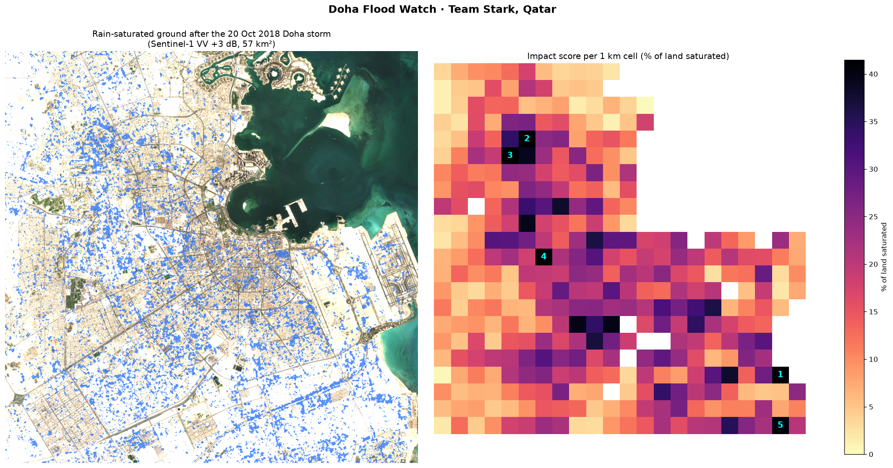
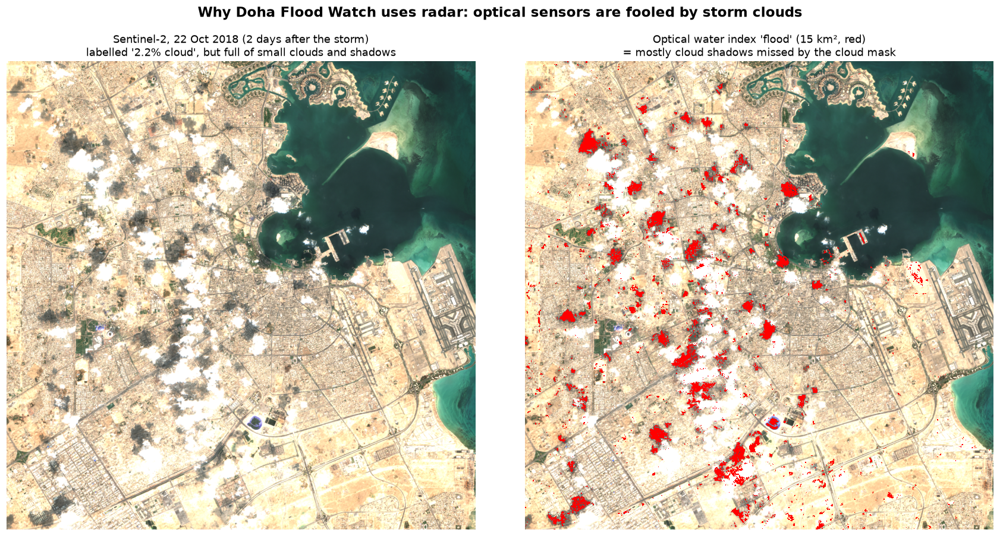

# Doha Flood Watch

Rain-flood impact mapping for Qatar using free Sentinel-1 radar images.

| | |
|---|---|
| Team | Stark |
| Country | Qatar |
| Theme | Climate-induced Disasters |
| Challenge | Arab Youth Space Hackathon 2026, 813 Challenge (Proof of Concept) |
| Live interactive map | [an0m1z3r.github.io/doha-flood-watch/results/doha_flood_impact_map.html](https://an0m1z3r.github.io/doha-flood-watch/results/doha_flood_impact_map.html) |

We compare radar images of Doha from before and after a storm to find where the ground became saturated with rainwater. The notebook then works out how much of each land-cover type was affected and ranks 1 km cells, so that drainage, municipal and emergency teams can see which neighbourhoods to check first. Our test case is the Doha flood of 20 October 2018.



## 1. Business use case

Four groups in Qatar have to make decisions after heavy rain:

| User | What they need to decide |
|---|---|
| Ashghal (Public Works Authority) | Which neighbourhoods drain worst, where to send tanker pumps after a storm, and where drainage upgrades are needed |
| Ministry of Municipality | Where new development is planned on ground that floods |
| Qatar Civil Defence / Ministry of Interior | Where to respond first, based on a picture of the whole city |
| Insurers in Qatar | Which property and motor claims to look at first, and how to price flood risk by location |

The question they all share is: after this storm, which neighbourhoods were hit hardest, and where do we send people first? If the same analysis is run over several storms, it also shows which areas flood every time and probably need permanent drainage work.

At the moment this information comes from hotline calls, field patrols and social media. It takes time to put together for a whole city, and it leans towards busy roads where people report problems. Drone or aircraft surveys cost more and can't fly in storm weather.

Doha Flood Watch gives a map of the whole city after each satellite pass. Radar works through cloud, the data is free (Copernicus), and the results come out as a map image, an interactive web map and CSV tables that open in GIS software or Excel.

## 2. The problem

Qatar gets only about 75 mm of rain in an average year, and its drainage was designed with that in mind. The country is very flat, and most of the city is covered by asphalt, buildings or desert surfaces that soak up little water. So when a big storm comes, the water stays where it lands. It collects in streets, underpasses and low ground, and the soil stays saturated for days.

On 20 October 2018 Doha recorded roughly a year's rain in one day, and roads, underpasses and buildings flooded across the city.

Street reports can't give a picture of the whole city, but a satellite can cover it in one pass. The problem with optical satellites such as Sentinel-2 is cloud, which is usually around after rain. In this project we found that small clouds and their shadows over Doha showed up as false flood water in an optical water index (see the limitations in section 8). Sentinel-1 is a radar satellite and sees through cloud day and night, so we based the project on it.

## 3. Data used

| Dataset | Provider | Date(s) | Processing level | Licence |
|---|---|---|---|---|
| Sentinel-1 Radiometrically Terrain Corrected (RTC), VV polarisation | ESA Copernicus, RTC processing by Catalyst; accessed via Microsoft Planetary Computer (`sentinel-1-rtc`) | 2018-10-03 (dry baseline), 2018-10-15 (before), 2018-10-27 (after); all Sentinel-1A, ascending orbit, 14:41 UTC | Level-1 GRD, terrain corrected to RTC gamma-nought (linear), then converted to dB | Copernicus Sentinel data: free and open. RTC product: CC BY 4.0 |
| Sentinel-2 L2A, bands B04/B03/B02 | ESA Copernicus via Microsoft Planetary Computer (`sentinel-2-l2a`) | 2018-10-12, tiles T39RWJ / T39RWH | Level-2A surface reflectance | Copernicus Sentinel data: free and open |
| ESA WorldCover 10 m v200 | ESA WorldCover consortium via Microsoft Planetary Computer (`esa-worldcover`) | 2021 map | Land-cover classification | CC BY 4.0 |

The exact scene IDs are listed in [`data/sample_input/provenance.json`](data/sample_input/provenance.json).

Area of interest: central Doha, Al Rayyan and the northern edge of Al Wakrah. The bounding box is `[51.40, 25.18, 51.62, 25.38]` (lon/lat), about 22 × 22 km, analysed at 20 m resolution in UTM zone 39N (EPSG:32639).

## 4. Technical approach

The notebook runs these steps in order:

1. We clip all layers to the area of interest and put them on the same 20 m grid (`floodmap.download_inputs` / `read_inputs`).
2. We remove permanent water (WorldCover class 80) and a 300 m strip along the shoreline. The strip takes out wind-roughened shallow sea and land that was reclaimed after 2018 (`land_mask`).
3. Each radar image gets a 5 × 5 median filter to reduce speckle (`despeckle`).
4. We compare VV backscatter after the storm with before, in dB (`detect_change`).
   - Wet ground: backscatter went up by more than 3 dB. Water raises the soil's dielectric constant, so wet sand, gravel, empty lots and road shoulders send more energy back to the satellite.
   - Standing water: backscatter went down by more than 3 dB and is now below −15 dB, because a smooth water surface reflects the signal away. Patches smaller than 4 pixels are dropped.
5. To check for false alarms, we run exactly the same detector on a pair of images from a dry period (3 to 15 October, no rain). Anything it finds there is a false alarm (`false_alarm_check`). We also repeat the detection with thresholds from 2 to 5 dB.
6. We measure wet ground and standing water for each WorldCover class (`exposure_table`).
7. We sum the results into 1 km cells and give each cell the percentage of its land that is saturated (`impact_grid`).
8. The notebook saves a static map, an interactive Folium map and CSV tables.

The functions are in [`src/floodmap.py`](src/floodmap.py) and the notebook is [`notebooks/01_doha_flood_mapping.ipynb`](notebooks/01_doha_flood_mapping.ipynb).

## 5. Installation

Requires Python 3.11 or 3.12. We tested it on Windows 11 with Python 3.12.10.

```bash
git clone https://github.com/AN0M1Z3R/doha-flood-watch.git
cd doha-flood-watch
python -m venv .venv
# Windows:      .venv\Scripts\activate
# macOS/Linux:  source .venv/bin/activate
pip install -r requirements.txt
```

You don't need any API keys or accounts. The sample data is in the repo, and re-downloading uses the free Microsoft Planetary Computer STAC API without login.

## 6. How to run

```bash
jupyter lab notebooks/01_doha_flood_mapping.ipynb
```

Then pick Run All Cells from the Run menu.

Or, without opening Jupyter:

```bash
jupyter nbconvert --to notebook --execute --inplace notebooks/01_doha_flood_mapping.ipynb
```

It takes about a minute on a normal laptop and doesn't need a GPU. It reads the GeoTIFFs in `data/sample_input/` and writes these files to `results/`:

| File | What it is |
|---|---|
| `doha_flood_impact_map.png` | The two-panel map shown at the top of this page |
| `doha_flood_impact_map.html` | Interactive web map (opens in any browser) |
| `exposure_by_landcover.csv` | Affected km² for each land-cover class |
| `impact_grid_1km.csv` | Every 1 km cell with its score and corner coordinates |
| `top15_priority_cells.csv` | The 15 highest-ranked cells |

To download the inputs again, or to run a different area or date in Qatar, change `AOI_BBOX`, `S1_DATES` and `S2_DATE` in section 2 of the notebook and either delete `data/sample_input/*.tif` or set `DOWNLOAD = True`. The download takes about 20 seconds.

## 7. Example input and output

Input (`data/sample_input/`, about 8 MB):

| File | Content |
|---|---|
| `s1_vv_db_baseline_2018-10-03.tif`, `s1_vv_db_before_2018-10-15.tif`, `s1_vv_db_after_2018-10-27.tif` | Sentinel-1 VV backscatter, dB × 100, int16, 20 m |
| `s2_rgb_2018-10-12.tif` | Sentinel-2 true-colour background, 8-bit |
| `worldcover_2021.tif` | ESA WorldCover land-cover classes |
| `provenance.json` | Exact scene IDs used |

Output: the map at the top of this page and the CSV files in [`results/`](results/).

## 8. Results and limitations

### Results for the 20 October 2018 storm

| Measure | Value |
|---|---|
| Land analysed (after removing sea and the shoreline strip) | 361 km² |
| Rain-saturated ground, one week after the storm | 57.5 km² (15.9% of the land) |
| Same detector on a dry week (false alarms) | 4.5 km² |
| Signal-to-noise | 12.6× |
| Built-up land saturated | 42.2 km², 17.9% of all built-up land |
| Bare or sparse land saturated | 14.7 km², 12.5% |
| Most affected 1 km cell | 57.5% of its land saturated |

We wanted to check that the result doesn't depend on the 3 dB threshold we picked. At every threshold from 2 to 5 dB, the storm signal stays between 7 and 13 times the dry-week false alarms:

| Threshold (dB) | 2.0 | 2.5 | 3.0 (used) | 3.5 | 4.0 | 5.0 |
|---|---|---|---|---|---|---|
| Storm, wet km² | 138.5 | 91.8 | 57.5 | 34.8 | 20.7 | 7.4 |
| Dry week, false km² | 11.8 | 7.1 | 4.5 | 3.0 | 2.1 | 1.0 |
| Signal-to-noise | 11.8 | 13.0 | 12.6 | 11.6 | 10.0 | 7.3 |

### Validation

There is no official flood map for this storm, so we used a dry-week control instead: the same method on two radar images 12 days apart with no rain in between. Whatever it flags there is a false alarm. All three radar images come from the same satellite, orbit and time of day, so the comparison is like for like.

### Limitations

- In 2018 Sentinel-1 passed over Doha every 12 days on this orbit, and the first image after the storm is from 7 days later. By then most surface water had been pumped away, drained or evaporated. That is why we map saturated ground rather than the peak flood. The standing water we detected at day 7 (0.08 km²) is not above the dry-week noise (0.06 km²), so we don't count it as a result.
- We first tried an optical water index (MNDWI) on the Sentinel-2 image from 22 October, two days after the storm. The image is labelled 2.2% cloud, but small clouds and their shadows over Doha came out as false flood patches that the official cloud mask missed. This is the main reason we switched to radar. You can reproduce it with `python src/make_why_radar_figure.py`.

  
- In dense built-up areas, walls and the ground together give strong "double-bounce" radar echoes that can hide water in narrow streets. The built-up results mostly come from open ground, roadsides and empty lots inside neighbourhoods.
- WorldCover is a 2021 map and the storm was in 2018. Parts of Doha changed in between (World Cup construction, for example), so the numbers per land-cover class are approximate.
- We haven't compared the ranked cells with real records yet. Ashghal's flooding hotspot records or hotline logs from October 2018 would be the obvious check.

### Next steps (incubation)

1. Combining Sentinel-1A, Sentinel-1C (launched December 2024) and commercial radar would give images within 1 to 3 days of a storm, early enough to see standing water as well as wet ground.
2. Running every major Qatar rain event since 2015 (November 2015, October 2018 and later ones) would show which cells flood every time. Drainage planners could use that as a hotspot atlas.
3. Hyperspectral data from 813 or EnMAP could separate wet soil, standing water and dark urban surfaces better than broad-band sensors, in clear-sky scenes after a storm.
4. We would turn the notebook into an automated service on Space42's GIQ platform. It would start when the Qatar Meteorology Department issues a heavy-rain alert and send the map to agencies a few hours after the next satellite pass.

## 9. Repository structure

```
.
├── README.md
├── requirements.txt
├── LICENSE
├── notebooks/
│   └── 01_doha_flood_mapping.ipynb   # main analysis, run end to end, outputs saved
├── src/
│   ├── floodmap.py                   # data access, change detection, exposure, ranking
│   ├── make_why_radar_figure.py      # optical-vs-radar comparison figure
│   └── make_slide_figures.py         # figures used in the presentation
├── data/sample_input/                # clipped example inputs (~8 MB) + provenance.json
├── results/                          # map PNG, interactive HTML map, CSV tables
├── docs/
│   ├── slides.pdf                    # presentation (exported from presentation/)
│   └── figures/                      # figures for README and slides
└── presentation/                     # Slidev source for the slides (slides.md, style.css)
```

To rebuild the slides (needs Node.js 20 or newer):

```bash
python src/make_slide_figures.py
cd presentation
npm install
npx playwright install chromium
npm run export        # writes docs/slides.pdf
```

`npm run dev` opens the presenter view with speaker notes.

## 10. Team, licence and attribution

Team Stark, Qatar:

| Member | Role |
|---|---|
| Ali AlHenzab | Team lead and business: business model, stakeholder contact, pitch |
| Abdulla AlMuhaza | Software and data: notebook, code, repository, interactive map |
| Hamad Abusheraida | Satellite data: Sentinel-1 radar processing, flood detection, validation |
| Fahad AlMuraikhi | Impact and user research: Qatar flood context, user interviews, SDG and Vision 2030 alignment |

Code licence: MIT (see [`LICENSE`](LICENSE)).

Data attribution:

- Contains modified Copernicus Sentinel data (2018), processed by ESA.
- Sentinel-1 RTC data © Catalyst / Microsoft Planetary Computer, CC BY 4.0.
- © ESA WorldCover project 2021, contains modified Copernicus Sentinel data (2021) processed by the ESA WorldCover consortium, CC BY 4.0.
- Data accessed through the [Microsoft Planetary Computer](https://planetarycomputer.microsoft.com).

Built with pystac-client, odc-stac, rioxarray, xarray, SciPy, Matplotlib and Folium, for the Arab Youth Space Hackathon 2026 (UAE Space Agency, National Space Academy and Space42). We started from the official hackathon repository, [813-hyperspectral-hackathon](https://github.com/Tnecniv-Teikram/813-hyperspectral-hackathon).
